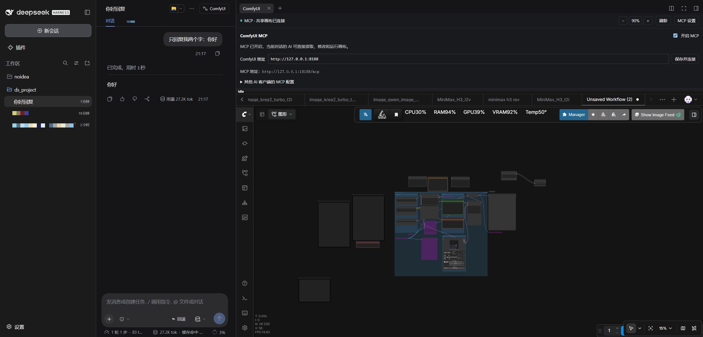
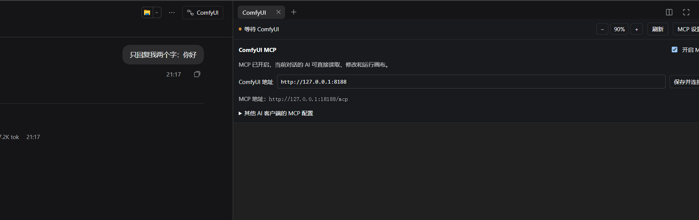
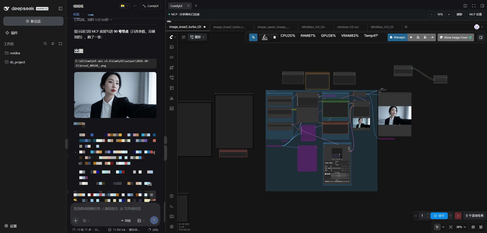

# dsh-comfyui-web

把 ComfyUI 放进 dsh 网页端：左边和 AI 聊需求，右边操作工作流、查看实时预览，整个过程都在同一个页面里完成。

你可以继续用鼠标改节点，也可以直接让 AI 改提示词、调参数、连接节点、切换工作流和提交生成。AI 的修改会显示在 ComfyUI 画布上，生成的图片和视频会自动出现在对应回复下方。



*进入 dsh 对话后，点击右上角 ComfyUI，在右侧打开工作台。*

## 可以做什么

| 功能 | 使用体验 |
|---|---|
| 同页操作 | 在 dsh 中使用 ComfyUI 界面，编辑节点、查看预览，不用来回切换浏览器标签页。 |
| AI 修改工作流 | 改提示词和参数，新增、删除、移动节点，连接或断开节点；修改实时显示在画布上。 |
| 工作流标签页管理 | 列出、切换和打开工作流，根据当前或已保存的工作流创建副本。 |
| 保存与另存 | 保存当前工作流，或另存为新的工作流文件。 |
| 对话参考图 | 将 dsh 对话中上传的图片送入 ComfyUI，并填入对应图片节点。 |
| 生成与结果查看 | 右侧看实时预览，对话中查看图片、播放视频；收起工具过程也能继续看结果。 |
| 撤销与恢复 | 撤销、重做 AI 修改，查看修改前快照并恢复；同一浏览器刷新后仍可使用。 |
| 任务跟踪 | 查看本对话的生成任务，取消未开始的排队任务，生成完成后收到通知。 |
| 图片与视频模糊 | 按需遮挡对话中的生成结果，点击解除遮挡，也可以单独重新模糊。 |

## 安装与首次配置

### 1. 准备环境

需要已经安装：

- [dsh](https://github.com/deepseek-ai/deepseek-harness)：当前插件适配 `0.2.0-rc.2`。
- Node.js 22 或以上，以及 pnpm。
- 能在浏览器中正常打开的本机 ComfyUI。

先确认 ComfyUI 工作流可以正常运行，所需模型和自定义节点已经准备好。默认连接地址是 `http://127.0.0.1:8188`。

### 2. 安装插件

在终端中运行：

```sh
dsh plugin --profile web add github:mangfufu/dsh-comfyui-web
```

### 3. 填写前端扩展目录

首次使用需要填写 ComfyUI 的前端扩展目录，让面板能够连接并接受 AI 操作。

创建或编辑配置文件：

| 系统 | 配置文件位置 |
|---|---|
| Windows | `C:\Users\你的用户名\.dsh\comfyui\config.json` |
| Linux | `~/.dsh/comfyui/config.json` |

如果设置了 `DSH_HOME`，则使用该目录下的 `comfyui/config.json`。

```json
{
  "url": "http://127.0.0.1:8188",
  "frontendExtensionsDir": "D:/ComfyUI/python/Lib/site-packages/comfyui_frontend_package/static/extensions"
}
```

`url` 填平时打开 ComfyUI 的地址。`frontendExtensionsDir` 要替换成自己机器上的实际目录，示例中的 `D:/ComfyUI` 不能直接照抄。

<details>
<summary>不知道前端扩展目录在哪里？</summary>

如果 ComfyUI 使用 `comfyui_frontend_package`，目录通常位于它所使用的 Python 环境中：

- Windows：`…/Lib/site-packages/comfyui_frontend_package/static/extensions`
- Linux：`…/lib/python3.x/site-packages/comfyui_frontend_package/static/extensions`

可以用**启动 ComfyUI 的那个 Python 解释器**运行以下命令，输出完整目录：

```sh
python -c "from pathlib import Path; import comfyui_frontend_package as p; print(Path(p.__file__).parent / 'static' / 'extensions')"
```

整合包或便携版通常自带 Python，请把命令中的 `python` 换成它的 Python 路径。如果提示找不到模块，先确认没有误用系统中另一个 Python 环境；自定义前端部署则填写正在使用的实际扩展目录。

Windows 的 JSON 路径建议使用 `/`，如 `D:/ComfyUI/...`，避免反斜杠转义问题。

</details>

### 4. 启动并打开面板

1. 启动 ComfyUI，确认网页能正常访问。
2. 运行 `dsh web`，打开 `http://127.0.0.1:3080`。
3. 进入一个对话，点击右上角的 **ComfyUI**。
4. 首次配置后，刷新已打开的 ComfyUI 页面和 dsh 内的面板，等待顶部显示 **MCP · 共享画布已连接**。

如果填写配置时 dsh 已在运行，先保存工作流，再重启一次 `dsh web`，然后刷新 ComfyUI 页面。

## 连接地址与 MCP 设置

默认连接 `http://127.0.0.1:8188`。更换端口后，打开 **MCP 设置**，修改地址并点击 **保存并连接**。



*填写 ComfyUI 服务的根地址，例如 `http://127.0.0.1:8188`。*

MCP 默认开启，dsh 中的 AI 已自动接入，可以直接下指令。关闭 MCP 后，仍可手动使用 ComfyUI 界面；已经提交的生成任务会继续运行。

收起面板或切换浏览器标签页时，已建立的指令连接会保持。连接中断后会自动重连；浏览器休眠、网络断开或页面关闭时，需要恢复连接后才能继续操作。

如果要让本机其他支持 MCP 的 AI 客户端使用插件，展开 **其他 AI 客户端的 MCP 配置**，复制配置到对应客户端。使用时保持 dsh 和 ComfyUI 运行，并在目标 dsh 对话中打开 ComfyUI 面板。

## 日常使用示例

先打开要操作的工作流，再在当前对话中告诉 AI 你想做什么。建议说清楚要保留的模型、节点和参数，以及是否立即生成。

### 优化提示词并生成

> 读取当前工作流，优化正向提示词。保留现有模型、分辨率和节点连接，只生成一张图，然后查看效果。



*AI 修改时，右侧节点参数同步变化；提交后可以在 ComfyUI 中看预览，在对话里看结果。*

如果只想先调整工作流：

> 把采样步数改成 30，先不要生成。

### 使用对话中的参考图

先在 dsh 对话中上传图片，再发出指令：

> 用我刚上传的参考图做图生图。先读取当前工作流，把图片上传并填入对应图片节点，保持其他参数不变，先不要生成。

对话中有多张图片时，可以先让 AI 列出参考图，再指定使用哪张。

支持 PNG、JPEG、WebP 和 GIF。上传至 ComfyUI 的单张图片上限为 20 MB，dsh 自身的上传限制也会生效。工作流需要有可接收图片的节点；需要新增节点时，可以一并告诉 AI。

### 切换、复制和保存工作流

> 列出已打开的工作流标签页，切换到「视频测试」。

> 根据当前工作流创建一个叫「放大测试」的副本，在新标签页里调整，保留原工作流。

> 打开已经保存的「图生图」工作流。

调整完成后：

> 保存当前工作流。

> 另存为「视频测试第二版」。

保存使用当前工作流的文件名；另存会创建并打开新文件，保留源工作流。另存遇到同名文件时会提示换名称。

### 新增节点与调整连线

> 在当前工作流里加一个放大节点，接到图片输出前面。先检查已有节点和可用类型，不要生成。

也可以让 AI 删除不需要的节点、移动节点、连接或断开输入。一次批量编辑失败时，会恢复编辑前的工作流。

### 撤销、重做与恢复快照

> 撤销刚才的修改。

> 重做刚才撤销的修改。

> 列出当前工作流的修改快照，我想恢复到添加放大节点之前。

快照在**同一浏览器、同一对话和对应工作流**中保留，刷新后仍可使用；最多保留 20 份，实际数量受浏览器存储空间限制。清除浏览器站点数据会清除这些记录。

如果 AI 修改后，你又手动改了工作流，直接撤销或重做可能会被拒绝。这时先查看快照，确认要恢复到哪一步，再让 AI 恢复。

### 查看和取消任务

> 查看本对话的生成任务，告诉我哪些还在排队、哪些已经完成。

> 取消本对话还没开始的那个生成任务。

**取消排队**只删除指定的等待任务。已经开始的任务不会因此停止生成。

如果要停止当前生成，可以明确说：

> 中断 ComfyUI 当前正在生成的任务。

中断会影响**整个 ComfyUI 实例当前生成的任务**，它可能来自其他对话或手动操作。取消 dsh 中的完成通知，也不会停止 ComfyUI 生成。

## 生成结果与完成通知

通过插件提交生成后，图片和视频会自动显示在发起任务的回复下方，不需要再让 AI 调用显示工具。图片按原比例展示，多张图片放不下时换行；清晰图片可点击查看原图，视频可直接播放。

生成完成、失败或中断后，插件会通过 dsh 后台任务通知原对话，正在进行的回复不会被强行中断。等待期间可以继续聊其他内容。

插件重启后，会恢复已记录任务的跟踪和结果；原对话的 AI 恢复运行后，会重新接上尚未送达的完成通知。恢复跟踪不会重新提交生成。

在 ComfyUI 中手动提交的任务，可以让 AI 查找并展示历史结果：

> 查看最近的生成历史，把刚才生成的图片或视频用插件显示到对话里。

AI 要判断图片内容或评价效果，需要使用支持图片理解的模型。视频播放卡提供视频展示，不代表当前 AI 模型能够理解视频内容。

## 图片与视频模糊

顶部 **图片对话中模糊** 开关默认关闭，同时适用于本插件返回到对话中的图片和视频，开关状态会记住。

开启后：

- 图片先以毛玻璃效果遮挡，第一次点击只解除模糊，再点清晰图片可查看原图。
- 视频第一次点击只解除模糊，再通过播放按钮播放。
- 鼠标悬停时，左上角的灰色小眼睛可单独切换模糊与清晰；正在播放的视频重新遮挡后会暂停。

关闭总开关后，结果正常显示，不出现模糊提示或小眼睛。

模糊只影响本插件在 **dsh 对话结果区**显示的图片和视频。ComfyUI 画布与实时预览、用户上传图片、dsh 其他工具的图片，以及 AI 读取到的原图都不受影响。它不会自动判断内容是否为 NSFW。

## 面板常用按钮

| 按钮 | 用途 |
|---|---|
| `− / +` | 等比调整 ComfyUI 界面大小，范围为 50%–125%。 |
| 缩放百分比 | 点击恢复为 100%。 |
| 刷新 | 重新加载面板中的 ComfyUI 页面，刷新前建议保存工作流。 |
| 图片对话中模糊 | 开启或关闭对话结果的图片、视频模糊显示。 |
| MCP 设置 | 修改连接地址、开启或关闭 AI 操作、复制其他客户端的 MCP 配置。 |

## 更新

```sh
dsh plugin --profile web update dsh-comfyui-web --latest
```

更新前先保存工作流。更新完成后重新启动 `dsh web`，刷新 dsh 网页和已打开的 ComfyUI 页面；右侧面板也可用 **刷新** 按钮重新加载。

如果使用本地源码链接安装，请先更新对应源码目录，再重启 dsh 并刷新页面。

## 常见问题

### 一直显示“等待 ComfyUI”怎么办？

先确认 ComfyUI 已启动、连接地址能在浏览器中打开，再检查首次配置中的前端扩展目录。配置完成后重启 dsh，并刷新 ComfyUI 页面。

能看到界面但 AI 无法操作时，还需要检查 **MCP 设置**中的开关是否开启，以及工作流是否已经加载完成。

### 原 ComfyUI 网页和 dsh 面板内容不一样？

确认两边连接同一个 ComfyUI 服务，并打开同一路径的工作流。不同工作流各自保留内容，切换某一页的标签不会自动切换另一页。

更新插件后，要刷新两边已经打开的页面，让它们使用更新后的功能。

### 为什么连接正常时 AI 却报面板不可用？

先让 AI 检查当前对话的连接状态，确认面板属于正在操作的对话。连接断开和 MCP 开关关闭是不同情况；短时断线先等待重连，必要时刷新面板。

同一对话打开多个面板时，让 AI 根据连接状态明确选择目标面板。连接未恢复前，先停止改图与提交，避免另写脚本生成另一份工作流。

### 生成结束了，为什么对话中没出现结果？

自动结果对应通过插件提交的任务。手动点击 ComfyUI 的生成按钮产生的结果，可以让 AI 从历史记录中读取并显示。

如果是插件提交的任务，先刷新 dsh 网页，再让 AI 查看本对话任务。保留原任务继续查结果，避免重复提交。

### AI 提示缺少模型或节点怎么办？

先在 ComfyUI 中安装、选择工作流需要的模型和自定义节点，确认工作流能够正常生成，再让 AI 继续操作。

### 提交生成超时，要重新生成吗？

先让 AI 查看任务、队列或生成历史。提交超时不代表没有提交成功，确认原任务状态后再决定下一步。

### 换浏览器后找不到撤销记录？

撤销与快照保存在原浏览器中，不会自动迁移到另一个浏览器。长期保留的工作流，请使用 **保存** 或 **另存**。

## 交流与反馈

[提交问题](https://github.com/mangfufu/dsh-comfyui-web/issues) · [LINUX DO 介绍帖](https://linux.do/t/topic/3009797)

反馈时说明 dsh 与插件版本、出问题的操作步骤和报错提示；界面问题可以附上截图。

## 友情链接

[LINUX DO](https://linux.do/)

## Star History

[](https://www.star-history.com/?repos=mangfufu%2Fdsh-comfyui-web&type=date)
